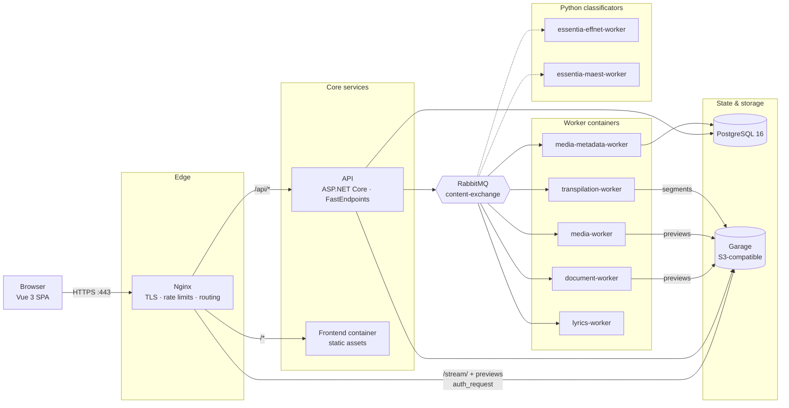

import { Aside } from '@astrojs/starlight/components';

Alexandria is a modular self-hosted stack. A Vue 3 SPA sits behind Nginx, talks to an ASP.NET Core API, which coordinates background work through RabbitMQ. PostgreSQL holds state, and S3-compatible object storage (Garage) holds file data. Everything ships as Docker Compose services defined in `docker-compose.local.yml`.

## The Big Picture

## Request Paths

Nginx is the single public entry point (ports 80/443). Every route terminates TLS there:

| Route | Destination | Notes |
|---|---|---|
| `/api/*` | `api:8080` | Reverse proxy; rate-limited |
| `/*` | `frontend:8080` | Static SPA assets |
| `/stream/*`, preview routes | Garage **web endpoint** (`:3902`) | Gated by Nginx `auth_request` subrequests to the API (`stream-check` / `preview-check`) before any byte reaches Garage |
| S3 endpoint | Garage S3 API (`:3900`) | Presigned browser uploads/downloads go here directly |

The streaming auth design matters: browsers never talk to Garage for streams without a validated session — Nginx asks the API first, then proxies to Garage's website-mode bucket endpoint.

## Docker Networks

Five isolated bridge networks (verified against `docker-compose.local.yml`):

| Network | Members | Purpose |
|---|---|---|
| `frontend-net` | nginx | Public edge |
| `app-net` | nginx, frontend, garage, api | Serving assets, API calls, presigned S3 traffic |
| `data-net` | api, all five .NET workers, postgres, garage, rabbitmq | Internal service traffic only |
| `essentia-net` | rabbitmq, essentia-effnet-worker, essentia-maest-worker | Python classificators are isolated — they see RabbitMQ and nothing else (no DB, no storage) |
| `observability-net` | prometheus, grafana, loki, alloy, cadvisor, postgres-exporter, api | Metrics/logs scraping; no external ports |

## Storage Layout

Garage holds five buckets (created idempotently by the init container / script):

| Bucket | Purpose | Written by | Read by |
|---|---|---|---|
| `alexandria-files` | Permanent file storage | Backend internal S3 client | Users via presigned GET |
| `alexandria-temp` | Upload staging area | Browser via presigned PUT | Backend (promotion) |
| `alexandria-previews` | Thumbnails, document previews, covers | Workers | Users via web endpoint (auth-gated) |
| `alexandria-images` | User background images | Browser via presigned PUT (CORS) | Browser via presigned GET |
| `alexandria-streaming` | DASH/HLS segments + manifests | Transpilation worker | Users via web endpoint (auth-gated) |

Three scoped access keys exist: `alexandria-master-key` (full access), `alexandria-preview-key` (read/write previews, read files), `alexandria-streaming-key` (read files, read/write streaming).

## Message Broker Topology

One durable topic exchange, `content-exchange`. Queues and routing keys (single source of truth: `rabbitmq/definitions.template.json`):

| Queue | Routing key(s) | Consumer |
|---|---|---|
| `document-queue` | `document.#` | document-worker |
| `media-queue` | `media.#`, `image.#` | media-worker |
| `transpilation-queue` | `transpilation.#` | transpilation-worker |
| `lyrics-queue` | `lyrics.#` | lyrics-worker |
| `classify-effnet-queue` | `media-metadata.classify.audio.effnet` | essentia-effnet-worker |
| `classify-maest-queue` | `media-metadata.classify.audio.maest` | essentia-maest-worker |
| `media-metadata-results-queue` | `media-metadata.completed.#` | media-metadata-worker |
| `media-metadata-trigger-queue` | `media-metadata.enrich.#` | media-metadata-worker |

<Aside type="note">
  Per-user RabbitMQ credentials are provisioned per worker (each worker gets its own username/password pair from `.env`) rather than sharing one account.
</Aside>

## Worker Fleet

All workers follow the same shape: consume a message → DI scope per message → download source from Garage → process → upload results → ack. See [Workers & Queues](/development/workers/) for internals.

| Worker | Job |
|---|---|
| `document-worker` | Office/PDF/archive/text previews (LibreOffice headless, Poppler, Ghostscript) |
| `media-worker` | Image/video/audio thumbnails, metadata extraction, preview clips (FFmpeg) |
| `transpilation-worker` | DASH/HLS adaptive-bitrate transcoding (FFmpeg) |
| `media-metadata-worker` | Enrichment orchestrator: batches audio for classification, consumes results, syncs auto-tags |
| `lyrics-worker` | Synced/plain lyrics fetching (Lrclib) |

The two Essentia classificators are Python containers doing TensorFlow inference on audio batches handed to them over RabbitMQ — see [Audio Analysis](/development/audio-analysis/).

## Monitoring Profile

Grafana, Prometheus, Loki, Alloy, cAdvisor, and postgres-exporter run under the `monitoring` compose profile (also enabled via `default`). Covered in detail in [Observability](/development/observability/).

---

<Aside type="note">**Verified against:** `docker-compose.local.yml` (services/networks/profiles), `Backend/AlexandriaBackend.slnx` (20 projects), `rabbitmq/definitions.template.json` (exchange/queues/bindings), `scripts/garage-init/init.sh` + `init-garage.sh` (buckets/keys), `nginx/nginx.conf` (routes/auth_request).</Aside>
