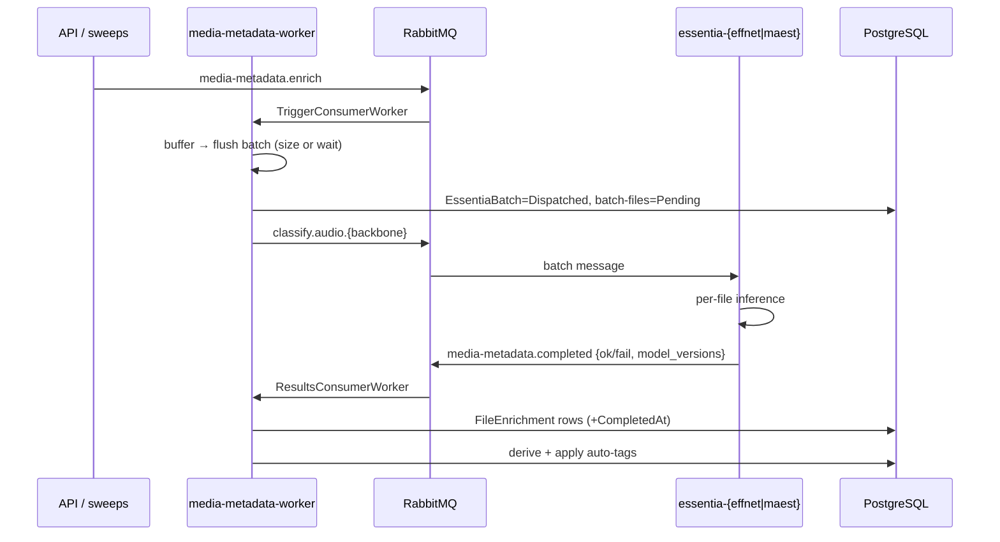

import { Aside } from '@astrojs/starlight/components';

Alexandria can analyze audio files (genre/mood) using TensorFlow models via [Essentia](https://essentia.upf.edu/), then turn the results into system tags automatically. The pipeline spans three runtimes: .NET orchestration (`media-metadata-worker`), Python inference (two classificator containers), and PostgreSQL for state.

## Design Invariants

- **Single-backbone dispatch** — config picks `Essentia:Backbone = effnet | maest`; exactly one runs. Mood analysis comes from whichever backbone ran.
- **Python owns model versions** — version identifiers come from the Python side's `model_versions` payload, never hardcoded in .NET.
- **Classificators are isolated** — the Essentia containers live on `essentia-net` where they can only see RabbitMQ; no DB, no storage access. All I/O flows through messages plus a shared `/data` volume that .NET cleans up.
- **Encrypted files are never dispatched** for analysis.

## Pipeline

### Batching

`AccumulatorBuffer` collects candidate files; `AccumulatorWorker` flushes when either `BatchSize` is reached or `MaxBatchWaitSeconds` elapses. Each batch becomes an `EssentiaBatch` row with per-file `EssentiaBatchFile` rows tracking outcomes.

The Python worker message contract (one message per batch) and result shape are documented in `classificators/essentia/README.md`.

### Resilience

| Mechanism | Behavior |
|---|---|
| `TimeoutSweepWorker` | Dispatched batches past the backbone timeout → `TimedOut`; pending files → failed enrichment rows. Runs at startup too, recovering batches stranded by restarts |
| `AutoTagSweepWorker` | Backstop sweeper: retries failed enrichments after `RetryCooldownHours` (default 24 h), re-publishing `media-metadata.enrich` |
| Per-file failures | A file that fails inference doesn't fail the batch; its own JSON records why |

## Models

Checksummed in `classificators/essentia/models/` (verified at container start against `models.sha256`):

| Backbone | Genre model | Extras |
|---|---|---|
| `effnet` | `genre_discogs400-discogs-effnet-1` | mood axes + voice/instrumental from EffNet embeddings |
| `maest` | `discogs-maest-30s-pw-519l-2` | genre only (mood persisted from whatever ran) |

## Auto-Tagging Layer

`Alexandria.Services.Storage/AutoTagging/` turns committed `FileEnrichment` rows into tags:

- **Winner selection per facet** — `AutoTaggingOptions.ModelPriority` (default `["maest", "effnet"]`) orders analyzers; the sync re-derives authority from current rows each run, so a weaker model can never regress a stronger verdict
- **Genre** — top-N predictions (default 3) above `ConfidenceThreshold` (default 0.1)
- **Mood** — axis poles above threshold (default 0.65); near-50/50 splits tag neither pole
- **Owner preference** — respects each user's `AllowAutoTagRegression` setting
- **Suppression semantics** — removing an auto-tag marks it `Suppressed` rather than deleted; re-adding overrides to `User`

Normal tagging happens in-process right after enrichment commits; `AutoTagSyncIntervalSeconds` (prod default 15 min) drives the safety-net sweep.

## Observing the Pipeline

Admin endpoints under `/admin/enrichment/` power the Audio Analysis admin pages: queue depth, stuck batches, failure rate, volume-by-hour, duration, and batch listings (`GetBatchesEndpoint`, `GetQueueDepthEndpoint`, `GetStuckEndpoint`, …). Per-file enrichment is exposed via the file `Enrichment` feature endpoint.

<Aside type="caution">
  The integrations/audio-analysis UI is under active development; endpoint shapes may still shift. Treat <code>plans/audio-analysis-monitoring-backend-plan.md</code> as the authoritative spec while it stabilizes.
</Aside>

## Configuration Quick Reference

| Setting | Where | Default |
|---|---|---|
| `Essentia:Backbone` | appsettings (media-metadata-worker) | `effnet` |
| `Features:Autotagging` | appsettings (API + metadata worker) | off unless enabled |
| `Tagging:ModelPriority` | appsettings | `["maest","effnet"]` |
| `Tagging:{Genre,Mood}:ConfidenceThreshold` | appsettings | 0.1 / 0.65 |
| `VERIFY_MODELS` | Essentia containers | `true` |

---

<Aside type="note">**Verified against:** `Workers.MediaMetadata/Workers/*` sources, `Services.Storage/AutoTagging/AutoTaggingOptions.cs` + service interfaces, `classificators/essentia/{README.md,worker.py,entrypoint.sh}`, `Features/Admin/Enrichment/` endpoints, `plans/essentia-enrichment-plan.md`, compose network wiring.</Aside>
