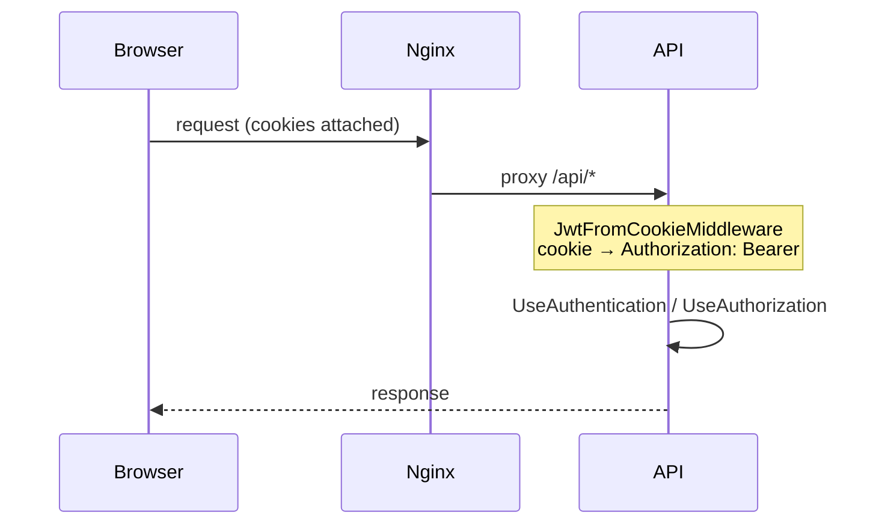

import { Aside } from '@astrojs/starlight/components';

Alexandria uses short-lived JWT access tokens plus rotating opaque refresh tokens, both in HTTP-only cookies. Roles are `User` and `Admin`; authorization is enforced through named ASP.NET Core policies. The frontend is a Vue SPA — there are no server-rendered sessions.

## Token & Cookie Strategy

| | Access token | Refresh token |
|---|---|---|
| Format | JWT (HMAC) | Opaque random string |
| Lifetime | 15 min (`Jwt:AccessTokenExpiryMinutes`) | 7 days (`Jwt:RefreshTokenExpiryDays`) |
| Cookie name | `access_token` | `refresh_token` |
| Cookie path | `/` (every request) | `/api/auth/refresh` only |
| Flags | `HttpOnly`, `Secure`, `SameSite=Lax` | same |

Claims on the access token: `NameIdentifier` (user GUID), `Email`, `Name`, one `Role` claim per role.

**Rotation:** every call to the refresh endpoint revokes the previous refresh token (`IsRevoked`/`RevokedAt` on the `RefreshToken` entity) and issues a fresh one. A background `RefreshTokenCleanupService` purges expired/revoked rows.

A special system account GUID (`…00000001`) is seeded for audit entries written outside a user context and cannot log in.

## Request Pipeline

`JwtFromCookieMiddleware` is deliberately tiny: if no `Authorization` header exists and an `access_token` cookie is present, it copies the value into the header. Everything downstream is standard ASP.NET Core JWT bearer validation.

Streaming previews never hit this pipeline — see below.

## Endpoints

Under `Backend/Alexandria.Api/Features/Auth/`:

| Endpoint class | Purpose |
|---|---|
| `Login` / `Logout` | Issue/clear both cookies; audit-logged |
| `RefreshToken` | Rotate tokens; scoped cookie path makes this the only endpoint receiving it |
| `ChangeInitialPassword` | Forced password change on first login of provisioned users |
| `ResetPassword` | Admin-initiated reset flow |
| `StreamCheck` / `PreviewCheck` | `auth_request` targets for Nginx (see [Architecture](/development/architecture/)) |

User management lives under `Features/Users/`: create/delete/update, restrict, profile setup, onboarding status + tour completion, per-user activity/file-count/storage usage.

## Roles & Policies

Registered in `AuthorizationExtensions.AddAuthorizationPolicies()`:

| Policy | Required role | Used for |
|---|---|---|
| *(default)* `RequireUser` | User or Admin | Most authenticated endpoints |
| `RequireAdmin` | Admin | Admin surfaces |
| `CanUpload` | User or Admin | Upload init/finalize |
| `CanDelete` | Admin | Destructive operations |
| `CanShare` | User or Admin | Share-link creation |

Roles come from ASP.NET Core Identity; the `AdminSeeder` provisions the initial admin from `.env`/appsettings credentials at startup.

## Streaming Auth Path

Browser requests to `/stream/*` and preview routes go to **Garage**, not the API. Nginx performs an `auth_request` subrequest to `StreamCheck`/`PreviewCheck`, which validate the caller's access token server-side; only on success does Nginx proxy the bytes from Garage's website-mode endpoint. This keeps session validation centralized while letting object storage serve heavy media traffic directly.

<Aside type="caution">
  Because access tokens expire after 15 minutes, long-running playback sessions depend on the frontend refreshing proactively — otherwise the next <code>auth_request</code> subrequest fails.
</Aside>

## Onboarding Flow

Newly created users progress through onboarding steps tracked on the user record (status endpoint + `SetupProfile` + `FinishTour`). Provisioned accounts land in a forced state: initial password change before normal use.

---

<Aside type="note">**Verified against:** `Features/Auth/*` endpoints, `Middlewares/JwtCookieMiddleware.cs`, `Login/LoginEndpoint.cs` + `RefreshToken/RefreshTokenEndpoint.cs` (cookie flags/paths), `Extensions/AuthorizationExtensions.cs` (policies), `Data.Models/RefreshToken.cs`, `Infrastructure/RefereshTokenCleanupService.cs`, `Data/Seeders/AdminSeeder.cs`, `AuthService.GenerateAccessToken` (claims).</Aside>
