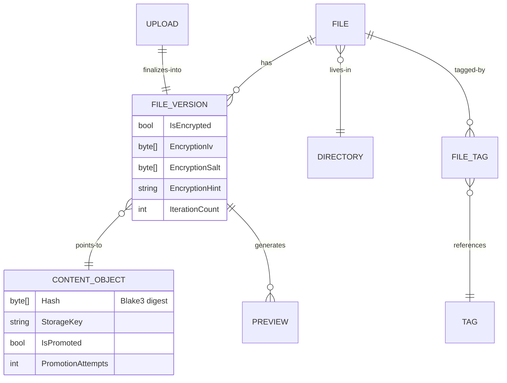

import { Aside } from '@astrojs/starlight/components';

PostgreSQL 16 accessed through EF Core 10 + Npgsql. The context (`AlexandriaDbContext` in `Alexandria.Data`) extends Identity's `DbContext<ApplicationUser, ApplicationRole, Guid>`, so ASP.NET Core Identity tables live alongside domain tables. Fluent configuration classes sit in `Alexandria.Data/Configurations/` — one per aggregate.

## Key Patterns

- **Content-addressed deduplication** — identical file content shares one `ContentObject` row (Blake3 hash), referenced by every `FileVersion` pointing at that content
- **Soft delete everywhere** — all major entities carry a nullable `DeletedAt`; queries must filter it explicitly (global query filters are not used for this)
- **Audit trail via interceptor** — `AuditInterceptor` writes `AuditLog` rows on entity changes
- **Full-text search as computed columns** — stored `tsvector` columns maintained by Postgres expressions, indexed with GIN
- **Client-side encryption metadata per version** — key material never reaches the server; only IV/salt/tag/hint are stored

## Entity Catalog

Verified against `Alexandria.Data.Models/` (28 entities):

| Area | Entities |
|---|---|
| Users & auth | `ApplicationUser`, `ApplicationRole`, `RefreshToken`, `UserSettings` |
| Files & directories | `File`, `FileVersion`, `ContentObject`, `Upload`, `Directory` |
| Previews | `Preview` |
| Tags | `Tag`, `FileTag` |
| Streaming & playlists | `MediaMetadata`, `TranspilationJob`, `StreamingRepresentation`, `StreamSession`, `StreamHistory`, `Playlist`, `PlaylistItem`, `TrackLyrics` |
| Sharing | `SignedUrl` |
| Policies | `DirectoryPolicy`, `PolicyRule` |
| Audit & ops | `AuditLog`, `OperationalEvent`, `AdminSettings` |
| Audio analysis | `EssentiaBatch`, `EssentiaBatchFile`, `FileEnrichment` |

## Core Storage Model



- **`Upload`** tracks the presigned-upload lifecycle (`temp` bucket → finalize → promotion into `files`)
- **`ContentObject.IsPromoted`** + attempt counters drive the background promotion/cleanup loop owned by in-API workers
- **Previews are version-based**: each `Preview` belongs to a `FileVersion` (a one-time migration moved them off numeric size configs)

### Encryption Metadata

`FileVersion` stores only what decryption needs: IV, PBKDF2 salt, integrity tag, an optional user-facing hint, and the iteration count used. The actual key is derived client-side from the user's password in a Web Worker — see [Frontend Internals](/development/frontend-internals/).

## Tags Model

Tags were rewritten to support system-defined taxonomies:

- **`Tag`** carries optional `ExternalKey` + `TagFacet` (genre/mood) for seeded system tags, plus self-referencing `ParentId` hierarchy
- **`FileTag`** join carries `Source` (`User`, `Auto`, `Embedded`, `Suppressed`) and a `Confidence` score populated for auto-tags
- Removing an auto tag flips it to `Suppressed` (tombstone) rather than deleting; re-adding overrides back to `User`

## Enrichment Tables

Added by the audio-analysis feature:

| Table | Purpose |
|---|---|
| `EssentiaBatch` | One classification batch dispatched to a Python worker (status machine incl. stuck detection) |
| `EssentiaBatchFile` | Per-file outcome within a batch, incl. terminal `CompletedAt` |
| `FileEnrichment` | Analyzer result persisted per file (e.g. genre/mood analyzers with model versions) |
| `OperationalEvent` | Monitoring incidents surfaced in the admin UI |

## Cross-Cutting Conventions

Every domain entity except `AuditLog` implements `IBase`, configured globally in `OnModelCreating`:

| Column | Meaning |
|---|---|
| `CreatedAt` | Auto-set on insert |
| `UpdatedAt` / `UpdatedBy` | Set on update |
| `DeletedAt` | Soft-delete marker |

## Search Infrastructure

Computed columns maintained by Postgres (not EF):

- `File.SearchVector`, `Directory.SearchVector`, `MediaMetadata.SearchVector` — `to_tsvector('simple', …)` over name/metadata, GIN-indexed
- `MediaMetadata.NormalizedSearch` — normalized text for trigram matching on artist/title

Search queries combine FTS ranking with trigram matching; the query builders live in `Alexandria.Repositories/Search/` (`Alexandria.Repositories.Search`).

### Document text

Body text of documents lives in `DocumentText`, one row per `ContentObject`, so copies of the same content share it:

- `Content` holds up to 5 M characters; `SearchVector` is written by the repository in SQL (not a computed column). When the whole text is too varied for Postgres's 1 MB `tsvector` limit, only the first 500 K characters are indexed and `IsTruncated` is set
- `Status` records the outcome (`Extracted`, `Empty`, `NoTextLayer`, `PasswordProtected`, `Failed`, `CopyProtected`); failures keep their error, attempt count and last attempt on the row
- A GIN index on `SearchVector`, filtered to live rows

File search reads it through the SQL function `matching_document_files(owner, tsquery)` (script in `Alexandria.Data/Sql/DocumentText/`). It is declared `SET enable_seqscan = off`, because the planner otherwise prefers scanning the toasted vectors (about 630 ms) over the index (about 17 ms). The search fetches the matching file ids first and passes them to the page and count queries as one array parameter (`f."Id" = ANY(@ids)`).

Ranking: whole-name similarity × 2 + `ts_rank`, plus 1.0 when the name holds every typed word and 0.5 when the document text matches. The name filter is `word_similarity(query, name) > 0.5`, which keeps typos in long names and leaves out names that only share a few letters.

## Migrations Workflow

A design-time factory (`Alexandria.Data/DesignTime/AlexandriaDbContextFactory`) lets `dotnet ef` target the data project directly without booting the API host:

```bash
cd Backend
dotnet ef migrations add <Name> --project Alexandria.Data --startup-project Alexandria.Api
dotnet ef database update   --project Alexandria.Data --startup-project Alexandria.Api
```

The API also applies pending migrations automatically on startup unless disabled. Migration history includes recent structural changes worth knowing about: lyrics tied to transpilation jobs, version-based previews, the tag-system rewrite, enrichment batches, and the operational-event table.

---

<Aside type="note">**Verified against:** `Backend/Alexandria.Data.Models/` (entity + enum listing), `Backend/Alexandria.Data/Configurations/` (28 configuration classes), `Backend/Alexandria.Data/Migrations/` (latest: AddOperationalEventTable, 2026-08), entity sources for `FileVersion`, `ContentObject`, `Tag`, `FileTag`.</Aside>
