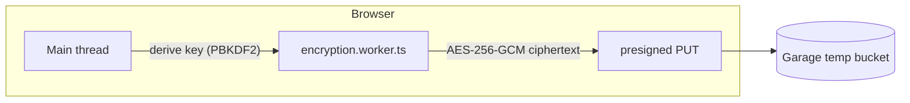

import { Aside } from '@astrojs/starlight/components';

The frontend is a Vue 3 + TypeScript SPA (Composition API + `<script setup>`), styled with Tailwind CSS v4 and Nuxt UI v4. Conventions, scripts, and the folder map live in `Frontend/README.md`; this page covers how it talks to the backend.

## Data Layers

| Layer | Tech | Role |
|---|---|---|
| State | Pinia stores (`stores/`) | Global state: auth/session, player, theme |
| Async data | `@pinia/colada` (`queries/`, `mutations/`) | Cache-aware queries with invalidation on mutations |
| HTTP | Thin `fetch` client with modules per resource (`api/`) | One module per backend feature area |
| Validation | Zod schemas (`schemas/`) | Runtime validation of API responses + form input |

Routes are defined in `router/` with auth guards; layouts split dashboard chrome from bare views (auth, onboarding, shared links).

## Client-Side Encryption

Files are encrypted **in the browser** before upload — the server never sees plaintext or key material.

Web Workers in `Frontend/src/workers/`:

| Worker | Job |
|---|---|
| `encryption.worker.ts` | Key derivation (PBKDF2, iteration count from server config) + AES-256-GCM encryption |
| `decryption.worker.ts` | Inverse path on download: fetch → decrypt → blob download |
| `blake3.worker.ts` | Client-side hashing used by the upload flow |

Metadata stored server-side per `FileVersion` (IV, salt, integrity tag, optional hint) is all a decrypted copy needs — see [Upload Pipeline](/development/upload-pipeline/).

<Aside type="caution">
  Keys derive from the user's password; there is no recovery path if it is lost. The hint field exists to help users remember.
</Aside>

## Upload & Download UX

- Uploads: presigned PUT straight to Garage (multipart-capable), progress tracked client-side; finalize triggers the async pipeline
- Downloads: presigned GETs; bulk selection streams as ZIP via `StreamBulkZipAsync`
- Previews/thumbnails load through Nginx's auth-gated preview routes

## Media Player

`components/streaming/` implements two skins — `AudioPlayerSkin.vue` and `VideoPlayerSkin.vue` — over one engine:

- `usePlayerStore` (Pinia): queue, current track, playback state
- `usePlayerEngine`: DASH/HLS playback against `/stream/*` URLs, library-context restoration for 
- `LyricsPanel.vue`: renders synced (LRC) lyrics when available — see [Lyrics reference](/reference/lyrics/)
- Queue/playlist UI components share the same store

## PWA

Serwist (`sw.ts`) provides the service worker; `dev-dist/` holds the dev-generated variant. The app is installable and offline-tolerant for shell assets.

---

<Aside type="note">**Verified against:** `Frontend/src/workers/` listing, `Frontend/README.md` tech table, `components/streaming/` tree, summaries/frontend + encryption-frontend cross-checked against directory layout.</Aside>
