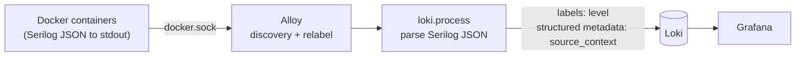

import { Aside } from '@astrojs/starlight/components';

The monitoring stack runs under the `monitoring` compose profile (also in `default`), all on the isolated `observability-net`. Two planes: **metrics** scraped by Prometheus into Grafana dashboards, and **logs** shipped by Alloy into Loki.

## Components

| Service | Role | Port |
|---|---|---|
| `prometheus` | Metrics scrape + storage | internal |
| `grafana` | Dashboards + log exploration UI | 3000/3001 (config) |
| `loki` | Log aggregation/storage | internal |
| `alloy` | Log collector: Docker socket discovery → Serilog JSON parsing → Loki | internal |
| `cadvisor` | Per-container CPU/memory/network metrics | internal |
| `postgres-exporter` | PostgreSQL internals as metrics | internal |

## Metrics Scraping

`prometheus/prometheus.yml` defines these jobs:

| Job | Target | What you learn |
|---|---|---|
| `alexandria-api` | API `/metrics` | App-level metrics incl. queue depths, enrichment stats |
| `garage` | Garage admin API (token-authenticated) | Object storage health, bucket usage |
| `rabbitmq` | Broker Prometheus plugin | Queue depth/delivery rates per worker queue |
| `cadvisor` | Docker daemon | Container resource usage across the stack |
| `postgres-exporter` | DB exporter | Connection counts, cache hit ratios, table bloat |
| `prometheus` | Self-monitoring | Scraper health |

Grafana datasources (Prometheus + Loki) and the dashboard provider are provisioned from `grafana/provisioning/`.

## Log Pipeline

Design choices worth knowing:

- Containers opt into collection via a Docker label; Alloy's relabel rules filter on it
- **Low-cardinality** fields (`level`) become Loki labels; **high-cardinality** fields (`SourceContext`) ride as structured metadata — queryable without blowing up the label index
- Timestamps are taken from the Serilog event, not ingestion time

## Application-Level Health

Separate from infra metrics:

- `/health` on every service (DB/storage/broker checks; API also probes worker health URLs)
- Admin monitoring surfaces: resource usage, server status, incident history with severity calendar — backed by the `OperationalEvent` table and `/admin/enrichment/*` analytics for the audio pipeline

## Access

Grafana credentials come from `.env` (`GRAFANA_USER`/`GRAFANA_PASSWORD`). When enabled via the installer or compose profile, the frontend port and Grafana port are configurable to avoid collisions.

<Aside type="caution">
  The observability services bind no external ports except Grafana — reach metrics/logs through its UI. Do not expose Prometheus/Loki directly.
</Aside>

---

<Aside type="note">**Verified against:** `prometheus/prometheus.yml` (6 jobs), `alloy/config.alloy` (discovery/relabel/process stages), `grafana/provisioning/*`, compose profile wiring + network placement.</Aside>
