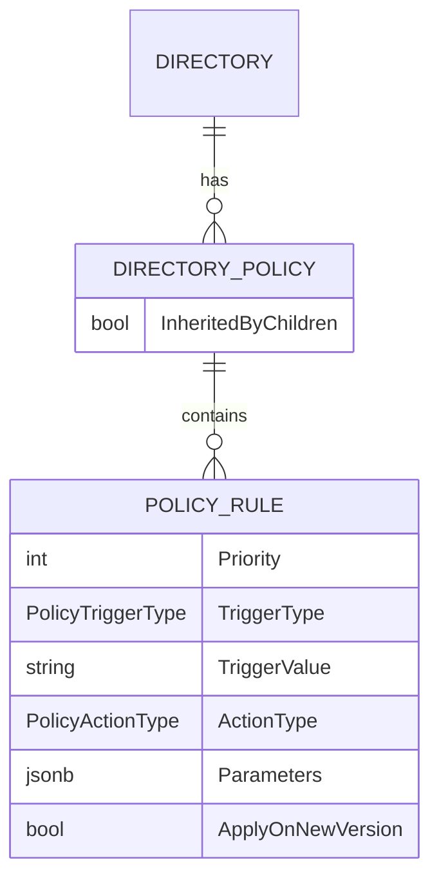

import { Aside } from '@astrojs/starlight/components';

Policies let users attach automation rules to directories: when files arrive or change, matching rules fire actions like transcoding or auto-tagging. Think "everything dropped into `Music/` gets analyzed and tagged".

## Data Model

- **`DirectoryPolicy`** binds to a directory; `InheritedByChildren` extends it down the tree
- **`PolicyRule`** = one trigger→action mapping with a priority for deterministic ordering

## Triggers & Actions

| Trigger (`PolicyTriggerType`) | Matches |
|---|---|
| `AnyFile` | Every file event in scope |
| `FileGroup` | MIME group match against `TriggerValue` (shared file-group definitions also drive upload UI grouping) |

| Action (`PolicyActionType`) | Effect |
|---|---|
| `Transcode` | Queues a transpilation job with parameters |
| `AutoTag` | Queues audio analysis enrichment |
| `Backup` | Queues a backup job |

(`Backup` is the roadmap action. The UI shows it as "Coming soon", `AddRule` rejects it, and the dispatcher skips any stored backup rule until a backup worker exists.)

## Dispatch Flow

`PolicyDispatcher` (in `Alexandria.Services.Storage/Policies/`) evaluates after finalize events:

1. Collect policies covering the file's directory chain (respecting inheritance)
2. Order rules by priority; skip non-matching triggers (`ApplyOnNewVersion` gates version-upload re-fires)
3. For each match, translate the rule's typed parameters into queue messages via `IJobQueue`

Because dispatch happens post-finalize, policy effects compose naturally with the [upload pipeline](/development/upload-pipeline/) — previews, promotion, and policy side-effects all proceed asynchronously.

## Management Surface

CRUD endpoints under `Features/Policies/`: create/update/delete policies and rules individually. The frontend renders them in the policy component area with per-directory scoping.

---

<Aside type="note">**Verified against:** entity sources (`DirectoryPolicy`, `PolicyRule`, enums), `Services.Storage/Policies/PolicyDispatcher.cs` (evaluation + parameter translation), `Features/Policies/` endpoints.</Aside>
