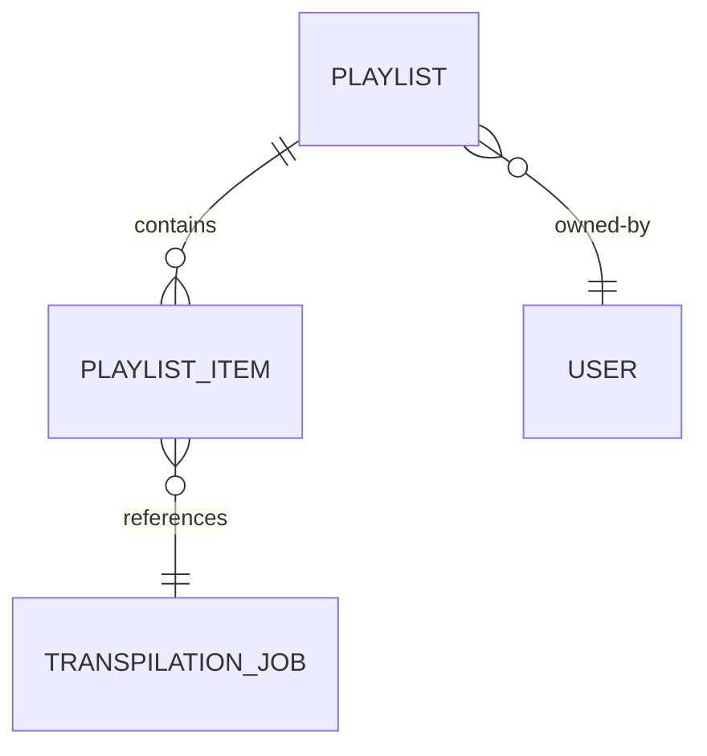

import { Aside } from '@astrojs/starlight/components';

Streaming turns uploaded audio/video into adaptive-bitrate DASH/HLS representations served straight from object storage, gated by server-side auth. Playlists and playback history build on transpilation jobs.

## Transpilation Pipeline

1. **Job creation** — `QueueTranspilationJob` (`Features/Streaming/`) creates a `TranspilationJob` and publishes `transpilation.*`
2. **Processing** — the [transpilation worker](/development/workers/) runs FFmpeg to produce codec-specific renditions (ladder rungs defined by `VideoRung`/`AudioRung`, codecs from `StreamCodec`)
3. **Representations** — each rendition is tracked as a `StreamingRepresentation` with its own status; manifests + segments land in `alexandria-streaming`
4. **Serving** — browser fetches `/stream/*`; Nginx validates via `auth_request` → API `stream-check`, then proxies Garage's website-mode endpoint

Status flows through the `TranspilationStatus` enum (queued → processing → ready/failed); the frontend polls job status before enabling playback.

<Aside type="caution">
  Streaming is feature-gated: <code>STREAMING_ENABLED=false</code> in <code>.env</code> keeps the whole subsystem off.
</Aside>

## Playback Tracking

| Entity | Purpose |
|---|---|
| `StreamSession` | One playback session (device/context) |
| `StreamHistory` | Individual play events for resume + "continue listening" |

The player store restores library context so a half-finished track resumes where you left it.

## Playlists

Key detail: **playlist items reference `TranspilationJob`s, not files** — playback quality selection rides on the same job that produced the segments.

- Ordering via `PlaylistItem.Position` with reorder endpoints
- Covers upload into previews bucket (`HasCover` flag)
- `AmbientTheme` stores an optional per-playlist visual theme the player picks up
- CRUD endpoints under `Features/Streaming/Playlists/`

## Lyrics Integration

When a track has a completed transpilation job, the lyrics system can attach synced/plain lyrics — see the dedicated [Lyrics reference](/reference/lyrics/).

---

<Aside type="note">**Verified against:** entity sources for `Playlist`, `PlaylistItem` (job reference), `StreamSession`, `StreamHistory`; enum listing (`TranspilationStatus`, `VideoRung`, `AudioRung`, `StreamCodec`, `RepresentationStatus`); `Features/Streaming/` tree; nginx stream routing.</Aside>
