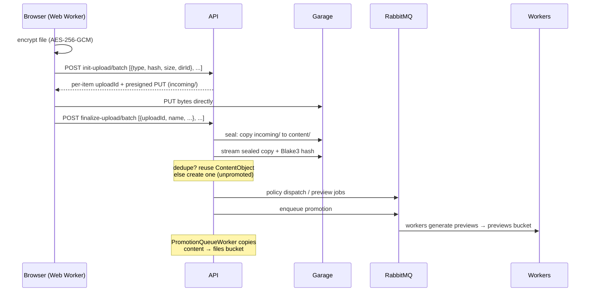

import { Aside } from '@astrojs/starlight/components';

Uploads are browser-direct: the client puts bytes straight into Garage's temp bucket via a presigned URL, so file data never transits the API. Finalization, deduplication, promotion, and preview generation all happen asynchronously afterwards.

## Flow at a Glance

## Phase Detail

**1. Client-side encryption.** Before any network call, a Web Worker derives an AES-256 key from the user's password (PBKDF2, iteration count from server config) and encrypts the file. Only ciphertext leaves the browser; IV, salt, integrity tag, and optional hint are stored as `FileVersion` metadata.

**2. Initiate.** `POST …/init-upload/batch` (`InitiateFileUploads`) takes up to 100 items, runs one quota check against their total size, creates an `Upload` row (`InProgress`) for each, and returns a presigned PUT targeting `incoming/{key}` in `alexandria-temp`. Batch URLs live for 2 minutes. If one has expired by the time a PUT slot frees up, the client requests a new one once. An invalid item or an unusable directory fails only its own items.

**3. Direct-to-S3.** The browser PUTs to Garage directly — CORS on the public S3 endpoint allows this. Large files benefit from multipart presigned uploads.

**4. Finalize.** `POST …/finalize-upload/batch` (`UploadBatchService`) handles each item independently, in two steps:

*Verify* runs up to 4 files in parallel and holds no database transaction:

1. **Claim.** An atomic update moves the `Upload` from `InProgress` to `Finalizing`, so a second finalize can't touch it.
2. **Seal.** A server-side copy moves the object from `incoming/{key}` to `content/{key}`. No URL is ever signed for `content/`, so a URL that is still live can't change bytes after they pass this point.
3. **Check.** The sealed copy is streamed back to compute its **Blake3 hash** and size, which must match what the client declared. A failure ends the upload as `Interrupted` and removes its objects.

*Commit* gives each file its own DI scope and a short transaction, and looks for a `ContentObject` with that hash:

- hit → new `FileVersion` reuses the content (dedup; no copy)
- miss → new `ContentObject` created unpromoted

Either way a `FileVersion` is attached (carrying encryption metadata), the `Upload` finishes, and dispatch work is queued. Up to 4 files commit in parallel, but files in a batch that share content or a destination commit one at a time, because they would otherwise race on the unique hash index or on creating the file. A failed commit retries once in a fresh scope to cover a collision with another batch. Repeating a request is safe, because an upload that already finished counts as a success.

**Batching on the client.** Each file used to cost two `/api` calls, which tripped the nginx rate limit on large folders. `features/upload/micro-batcher.ts` now groups requests and sends at most once per second per batcher, so uploads stay under the limit whatever the file sizes. Finalize batches are also capped at 1 GiB, and a larger file goes alone. `features/upload/run-window.ts` limits how many files are in progress at once (200 files or 1 GiB, always at least 4), which also bounds how long a signed URL can wait.

The single-file `init-upload` and `finalize-upload` endpoints share this code, including sealing, but the frontend no longer calls them.

**5. Policy dispatch & previews.** After finalize, the policy engine evaluates directory rules (e.g. auto-transcode media); the appropriate messages go out on `content-exchange`, and document/media workers generate previews into `alexandria-previews`.

**6. Promotion.** Two background services in `Alexandria.Services.Storage/Promotions/` move content from temp to permanent storage:

| Worker | Role |
|---|---|
| `PromotionQueueWorker` | Consumes the in-process promotion queue, copies `ContentObject`s into `alexandria-files`, marks them promoted |
| `PromotionScannerWorker` | Safety net: periodically finds unpromoted content (e.g. after a crash between queueing steps) |

`ContentObject.PromotionAttempts` / `LastPromotionAttemptAt` back off repeated failures.

**7. Cleanup.**

| Worker | Cadence | Job |
|---|---|---|
| `TempCleanupWorker` | every 10 min | Deletes temp-bucket objects older than 3 h, and anything left in `incoming/` after 72 h |
| `OrphanedCleanupWorker` | every 1 h | Removes DB/S3 rows that lost referential meaning (abandoned uploads, orphaned objects) |

<Aside type="caution">
  Because keys derive from the user's password, losing it means losing encrypted-file access — there is no server-side recovery. The optional <code>EncryptionHint</code> exists precisely to help users remember.
</Aside>

## Downloads

Downloads mirror the pattern inverted: the API issues presigned GETs against the public S3 client (`DownloadFileById`, version downloads, bulk ZIP streaming via `StreamBulkZipAsync`). Promoted content serves straight from `alexandria-files`; anything not yet promoted falls back to the internal path.

## Relevant Source Map

| Concern | Where |
|---|---|
| Presign/init/finalize/hash/dedup | `Alexandria.Services.Storage/S3Service.cs` |
| Promotion + cleanup services | `Alexandria.Services.Storage/{Promotions,Cleanup}/` |
| Batch finalize | `Alexandria.Services.Storage/Content/UploadBatchService.cs` |
| Upload endpoints | `Alexandria.Api/Features/Storage/Files/{InitiateFileUploadBatch,FinalizeFileUploadBatch,InitiateFileUpload,FinalizeFileUpload}` |
| Client batching | `Frontend/src/features/upload/{micro-batcher,run-window,upload-batches}.ts` |
| Upload state machine | `Data.Models/Upload` + `UploadStatus` enum |
| Client crypto | `Frontend/src/workers/` (see [Frontend Internals](/development/frontend-internals/)) |

---

<Aside type="note">**Verified against:** `S3Service.cs` (Blake3 hashing ~L1083, presign paths), `Features/Storage/Files/` endpoint listing, `Services.Storage/Promotions/*` + `Cleanup/*` (intervals read from source: 10 min/3 h temp, 1 h orphaned), `UploadStatus` enum, `ContentObject` entity.</Aside>
