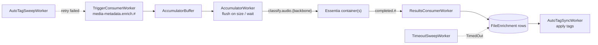

import { Aside } from '@astrojs/starlight/components';

Five .NET worker containers do Alexandria's asynchronous heavy lifting. They share one shape: connect to RabbitMQ, consume from `content-exchange`, create a DI scope per message, pull sources from Garage, write results back, ack.

## Common Infrastructure

Every worker registers the same core via `AddCoreWorkerServices()` (`Alexandria.Infrastructure/Workers/ServiceExtensions.cs`):

- **Database** — EF Core + Npgsql (unit of work per message scope)
- **Dual S3 clients** — internal client for backend↔Garage traffic
- **RabbitMQ consumer** — connection with retry, channel pool for publishers
- **Health endpoint** — `/health` on the worker's bound port
- **Serilog** — structured console logging

Each worker declares/binds its own durable queue (topology in [`rabbitmq/definitions.template.json`](/development/architecture/#message-broker-topology)) and runs as a `BackgroundService`.

## The Fleet

| Worker | Queue | Routing key | Job | Key tooling |
|---|---|---|---|---|
| document-worker | `document-queue` | `document.#` | Office→PDF, PDF text/archives/text extraction previews; document text sweep for search | LibreOffice headless, Poppler, Ghostscript, SharpCompress |
| media-worker | `media-queue` | `media.#`, `image.#` | Image previews + thumbnails, video poster frames, audio/video metadata, preview clips | FFmpeg, libvips (NetVips), sandboxed ImageMagick CLI fallback |
| transpilation-worker | `transpilation-queue` | `transpilation.#` | DASH/HLS adaptive-bitrate ladders for streaming | FFmpeg |
| media-metadata-worker | results + trigger queues (see below) | enrichment orchestration | Batch dispatch, result aggregation, auto-tag sync | — |
| lyrics-worker | `lyrics-queue` | `lyrics.#` | Synced/plain lyrics fetch + cache | Lrclib API |

The two Python Essentia classificators are separate containers on their own network — covered in [Audio Analysis](/development/audio-analysis/).

## Media Metadata Worker — Enrichment Orchestration

This worker is not a simple consumer; it orchestrates the audio-analysis pipeline. Hosted services (all in `Alexandria.Workers.MediaMetadata/Workers/`):

| Component | Responsibility |
|---|---|
| `TriggerConsumerWorker` | Consumes `media-metadata.enrich.#`; feeds candidate files into the buffer |
| `AccumulatorBuffer` + `AccumulatorWorker` | Drains buffer; flushes a batch on `BatchSize` or `MaxBatchWaitSeconds`; persists an `EssentiaBatch` (`Dispatched`) with `Pending` batch-files and enqueues the dispatch for the active backbone queue in the same transaction; triggers are acked after that commit |
| `ResultsConsumerWorker` | Consumes `media-metadata.completed.#`; updates batch/batch-file states; writes `FileEnrichment` analyzer rows with model versions reported by Python |
| `TimeoutSweepWorker` | Marks dispatched batches past backbone timeout as `TimedOut`, fails still-pending files; also runs once at startup to recover batches stranded while the worker was down |
| `AutoTagSweepWorker` | Re-enqueues enrich messages for files whose enrichment previously failed (bounded retry) |
| `AutoTagSyncWorker` | Applies tags from enrichment rows — see [Audio Analysis](/development/audio-analysis/) |

Backbone selection is config-driven (`Essentia:Backbone = effnet | maest`); exactly one is active and the routing key is derived from it.

## Document Worker — Text Sweep

Besides its queue consumer, the document worker runs `DocumentTextSweepWorker`, a timer-driven sweep that reads the body text of documents for [search](/development/database/#document-text). It is not a RabbitMQ consumer and creates no jobs:

- Each cycle picks up to `BatchSize` content objects of a supported type that are promoted, unencrypted and held by a live file, with no final row from the current extractor version. Newest uploads come first; copies sharing content are read once
- Readers: `pdftotext` for PDF (pages averaging under 20 visible characters count as a scan, `NoTextLayer`), streaming XML for OOXML and OpenDocument, the spine for EPUB, and plain text and Markdown as is. No LibreOffice
- A failure is stored on the row and retried after `RetryFailedAfterHours`, up to `MaxAttempts`; an admin can reset failures from the Previews page
- A cycle that fails as a whole (every download failed, or `pdftotext` missing) is reported through `WorkerCycleFailureRecorder` under the Document Previews service, so it raises an incident

Bumping `DocumentTextExtractor.CurrentVersion` makes the sweep read every document again with the new readers.

## Lyrics Worker

Split into its own project/container (`Alexandria.Workers.Lyrics`). It binds `lyrics-queue` at `lyrics.#`, runs configurable concurrent consumers (default 2 via `RabbitMQ:Consumer:Concurrency`), and handles lookup strategy, confidence scoring, and manual-upload protection — full detail in the [Lyrics reference](/reference/lyrics/).

## Publishing: the Outbox

Application code never sends to RabbitMQ directly. It calls `IOutbox.EnqueueAsync` inside the
unit-of-work transaction that writes the change, so the `OutboxMessages` row commits exactly
when the change does (enqueueing outside a transaction throws).

- Every host that publishes runs an `OutboxRelay`. A commit wakes the local relay at once; a
  5 s poll picks up rows left by other hosts or a crash. Relays share the table through
  `FOR UPDATE SKIP LOCKED`
- The relay publishes with broker confirms and `mandatory: true`, then marks the row sent. A
  refused or unroutable message backs off (5 s doubling, capped at 5 min) and is marked dead
  after `Outbox:MaxAttempts` (10), which raises a worker-cycle incident. A lost connection
  costs no attempt
- Delivery is at least once: the row id travels as `MessageId`, and consumers claim jobs, so a
  duplicate is acked without doing the work twice
- On a server with the broker turned off, enqueued messages are dropped instead of stored
- The admin integrations page shows the backlog and dead messages and can resend them; the
  `outbox` health check fails once the oldest unsent row waits over `Outbox:BacklogAlertMinutes`

## Consumption Semantics

- One DI scope per message; handlers resolve scoped repositories/services
- Ack only after the whole unit completes
- A failed delivery goes through `DeliveryRetry`: it is republished with a raised
  `x-delivery-attempts` header (confirmed before the original is acked) and parked once it
  reaches the worker's limit. Parking means the lyrics and trigger parking queues, an incident
  for the metadata results and backfill consumers, and failing the still-queued job for previews
- Preview handlers record a failure after the claim on the job and complete the delivery; the
  job recovery sweep retries it with backoff
- Workers tolerate broker downtime via connection retry loops

<Aside type="note">
  In-API background services (promotion, temp/orphan cleanup, refresh-token cleanup) are not RabbitMQ consumers — they're timer-driven <code>BackgroundService</code>s living in <code>Alexandria.Services.Storage</code> and <code>Alexandria.Infrastructure</code>. See <a href="/development/upload-pipeline/">Upload Pipeline</a>.
</Aside>

---

<Aside type="note">**Verified against:** `rabbitmq/definitions.template.json`, `Alexandria.Workers.MediaMetadata/Workers/*` doc-comments + routing keys in source, `Alexandria.Workers.Lyrics/LyricsWorker.cs` (queue/concurrency), `Infrastructure/Workers/ServiceExtensions.cs` (AddCoreWorkerServices), `Infrastructure/Messaging/Outbox/*` and `Infrastructure/Messaging/DeliveryRetry.cs` (2026-11-24).</Aside>
